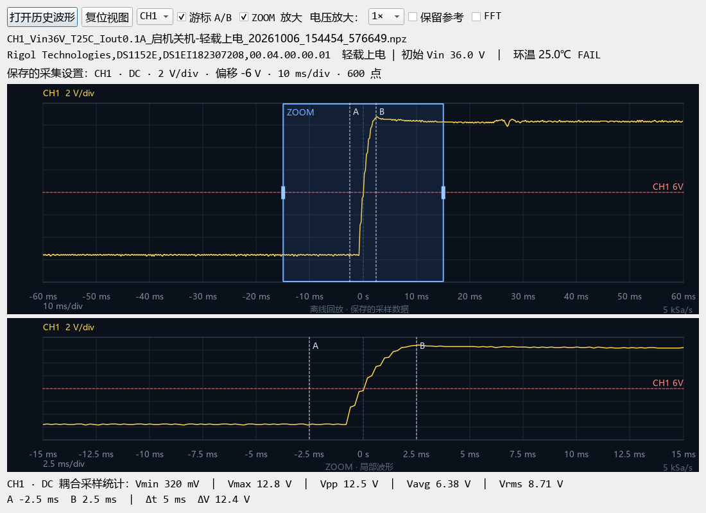

# 电源自动化测试上位机 · AutoTestHost

基于 Python / PyQt5 的 Windows 电源测试工具，完成仪器连接、规格配置、用例生成、逐工况执行、波形归档和 Excel 报告。内置 ScopeHost 波形模块，支持离线缩放、游标和 FFT 分析。

当前实机验证台架：**36–48 V 输入、12 V / 30 W 单路 BUCK**，使用 OWON SPM6103、UNI-T UTL8212 和 Rigol DS1152E。



## 下载 Windows EXE

在 [v0.1.0 Release](https://github.com/sunzhanjie2-sudo/power-supply-auto-test/releases/tag/v0.1.0) 下载 `AutoTestHost-v0.1.0-windows-x64.zip`，解压后双击 `AutoTestHost.exe`，无需安装 Python。也可单独下载 EXE 和 `SHA256.txt`。

GitHub 的“Code → Download ZIP”只包含源码。EXE 放在 Release 附件中，`dist/` 不纳入 Git 历史。仓库为私有仓库，需要有访问权限的 GitHub 账号才能下载。

程序沿用电脑已安装的仪器驱动：串口仪器需要对应 USB 转串口驱动；本项目实测 USB 示波器使用本机 VISA 后端。EXE 内置 Python 依赖，不包含厂商系统驱动。

## 主要功能与验证范围

| 功能 | 当前实现 |
| --- | --- |
| 工程配置 | 输入电压、温度、输出电压/功率、电压与纹波判据，工程 JSON 保存与加载 |
| 用例生成 | 1–7 路输出的 Excel 工况与结果布局，重复温度边界自动合并 |
| 仪器连接 | 串口、VISA / USB-TMC，自动识别当前台架仪器 |
| 自动测试 | 纹波与稳压精度、负载动态响应、输入/负载动态稳定度、启机关机 |
| 执行控制 | 后台执行、暂停、停止、逐工况保存；多路换线前关断并等待人工确认 |
| 波形记录 | 同一冻结帧的电压采样、原始 ADC 码和采集设置，PNG / CSV / NPZ / JSON |
| 波形查看 | ScopeHost 网格、时间缩放/平移、ZOOM、A/B 游标、电压放大、参考波形、FFT |
| 测试报告 | 工况值、PASS / FAIL / ERROR / SKIP / 未执行、异常原因、图片与文件链接 |

**当前全自动验证限于单路台架。** 多路输出采用人工换线后逐路测量，不代表支持多路同时加载或同步采集。环境温度由用户填写，不自动控制温箱。`test_engine/` 中保留的旧引擎、白盒测试和其他仪器型号，不属于当前四类黑盒流程的实机验证范围。

## 从源码运行

已验证开发环境为 Windows 11 x64、Python 3.13.6。建议使用独立虚拟环境；其他 Python 版本请先运行回归检查。

```powershell
git clone https://github.com/sunzhanjie2-sudo/power-supply-auto-test.git
cd power-supply-auto-test
python -m venv .venv
.\.venv\Scripts\python.exe -m pip install -r requirements.txt
.\.venv\Scripts\python.exe main.py
```

后续也可双击 `start_gui.bat`。启动脚本优先使用项目 `.venv`，不存在时使用系统 `python`。

## 仪器与接线

| 仪器 | 用途 | 已验证连接 |
| --- | --- | --- |
| OWON SPM6103 | DUT 直流输入 | 串口，115200 baud |
| UNI-T UTL8212 | CR 静态负载与电流动态负载 | 串口，9600 baud |
| Rigol DS1152E | 输出电压、纹波和瞬态波形 | USB-TMC / VISA，CH1 采集 |

串口号和 VISA 地址由当前电脑决定，不要求固定为历史台架的 COM3 / COM4。安装驱动并确认电源接 DUT 输入、负载接 DUT 输出、探头接被测输出后，点击“一键连接仪器”。探头倍率、接地、带宽和量程应与实际接线及测试目标一致。

修改接线或探头位置前关闭电源与负载。自动测试会实际给 DUT 上电并带载，开始前应核对输入边界、功率、限流和输出判据。

## 日常测试流程

1. 在“配置”填写样机型号、输入电压边界、输出通道和判据，选择报告输出目录。
2. 接好仪器后点击“一键连接仪器”。四类测试均需要电源、负载和示波器。
3. 打开“用例测试”，填写当前温度，勾选项目并点击“开始测试”；程序按最新配置生成工况。
4. 查看进度与逐项结果。暂停在当前工况结束后生效，停止后保留已完成的数据。
5. 测试结束后点击“打开报告”。选择已完成工况并点击“查看工况波形”，或双击该行回放。

“实时波形”复用示波器连接，不开启电源或负载。开始自动测试前会停止实时预览，避免并发访问仪器。“打开历史波形”支持 NPZ 和带 `Time_s` 的 CSV。

### 默认示例配置

| 参数 | 默认值 |
| --- | --- |
| 输入电压 | 36 / 42 / 48 V |
| 输出电压与满载功率 | 12 V / 30 W |
| 轻载 / 典型载 / 满载 | 0.1 / 1.25 / 2.5 A |
| 输出电压判据 | 11.4–12.6 V |
| 纹波判据 | 标称输出电压的 3%，即 0.36 Vpp |
| 环温 | 25℃，相同温度边界合并 |

这些是当前样机的**示例判据**，正式验收应按规格书填写。默认单路完整流程为 12 项。满载下电按额定 2.5 A 执行，不施加超额负载；启机关机只判上冲，正常下电归零不按稳压下限判失败。

## 报告与波形文件

每次测试建立独立的带时间戳目录，避免覆盖历史结果：

```text
test_reports/
└─ 型号_时间戳/
   ├─ 型号_黑盒测试用例.xlsx
   ├─ 型号_黑盒测试报告.xlsx
   └─ 黑盒测试/测试项/
      ├─ 工况_时间戳.png
      ├─ 工况_时间戳.csv
      ├─ 工况_时间戳.npz
      └─ 工况_时间戳.json
```

默认写入程序旁的 `test_reports`，目录不可写时回退到 `%LOCALAPPDATA%\AutoTestHost\test_reports`；也可在配置中指定位置。缓存与窗口版运行日志位于 `%LOCALAPPDATA%\AutoTestHost`。

- **执行汇总**是整次计划是否通过的依据，包含全部计划工况及状态；其他测试页的结论只统计已测数据。
- **PASS**：必需数据完整且满足工程判据；**FAIL**：测量完成但超限；**ERROR**：控制、采集或归档异常；**SKIP / 未执行**不能视为通过。
- **CSV**：`Index,Time_s,Voltage_V`，时间单位秒、电压单位伏。
- **NPZ**：电压采样、原始 ADC 码、时基、量程、偏移、耦合与工况，兼容 ScopeHost 格式。
- **PNG**：从保存的采样重建波形，并按像素保留峰值；不是仪器原生屏幕像素截图。
- **JSON**：采集设置、工况、判据和结果。搬运报告时保留整份目录，以维持相对文件链接。

缩放、游标和 FFT 不修改原始采样。DS1152E 当前读取 600 点屏幕记录，时间轴与 FFT 使用传输记录的有效点间隔，不代表仪器最高 ADC 采样率。纹波工况的 AC 波形与独立 DC 稳压测量应分别解释。

## 检查与复验

### 离线软件回归

不连接或开启仪器：

```powershell
.\.venv\Scripts\python.exe -m unittest discover -s tests -v
```

覆盖串口单读取线程、状态确认与有限重试、单次触发、波形极性/零点、缺失数据判定、1–7 路结果映射、报告保存保护、NPZ/CSV 一致性和离线波形交互。

### 仪器与界面自检

```powershell
.\.venv\Scripts\python.exe main.py --selftest
```

该检查会连接真实仪器并检查界面、实时波形入口，不执行完整 DUT 测试流程。

### 完整实机核验

**下面命令会给 DUT 上电并带载。**

```powershell
.\.venv\Scripts\python.exe main.py --verify-hardware --output test_reports\verification
```

可选参数：`--quick` 每类只测一项；`--kinds ripple,dynamic` 选择项目；`--config 工程.json` 加载单路工程；`--temp 25` 选择温度块。生成 `verification.json`、GUI 日志和报告，核对 GUI 与报告数值、波形归档、离线查看和最终关断状态。

退出码 `0` 表示全部工况通过；`1` 表示存在未通过工况或核验异常。`software_validation` 记录报告/归档核验结果，`success` 记录整体工况是否全部通过，两者含义不同。仪器异常保留 ERROR 状态和原因。

EXE 支持同样的参数，另可用 `--log-file 路径` 指定日志。打包程序的实机核验脚本为 `tools/test_exe.ps1`。

## 已有验证记录

| 日期 | 验证 | 结果 |
| --- | --- | --- |
| 2026-10-31 | 本次上传前离线回归 | 20/20 通过 |
| 2026-10-06 | 打包后界面与仪器连接自检 | 53/53 通过 |
| 2026-10-06 | 12 项单路实机测试 | PASS 9、FAIL 3、ERROR 0 |
| 2026-10-06 | 波形与报告核验 | 12 份归档一致，原 ScopeHost 读取器全部读取成功 |

历史实机未通过项为两项动态稳定度和一次轻载上电，仍保留真实 FAIL，不是样机全部合格的结论。本次上传未重新执行硬件测试。详细记录见 [波形集成验证](docs/waveform_integration_20261006.md) 和 [首轮验证](docs/verification_20261006.md)。原始报告与全量波形保留在本机 `test_reports/`，不纳入源码仓库。

## 重新打包

```powershell
powershell -NoProfile -ExecutionPolicy Bypass -File .\build_exe.ps1
```

或双击 `build_exe.bat`。脚本安装 `requirements-build.txt`，根据 `AutoTestHost.spec` 生成 `dist/AutoTestHost.exe`、使用说明和 `SHA256.txt`。构建依赖已安装时可加 `-SkipInstall`；当前构建工具固定为 PyInstaller 6.22.3。

## 项目结构

```text
main.py                  程序入口与检查命令
auto_test/
  communication/         串口、VISA、USB-TMC 通信
  config/                工程与边界配置
  gui/                   配置、调试、用例与实时波形界面
  instruments/           电源、电子负载、示波器驱动
  test_case/             当前用例生成与执行
  reporting/             执行汇总、Excel 回填与波形归档
  waveforms/             内置 ScopeHost 模型、归档、渲染与 PyQt5 回放
  test_engine/           保留的旧测试引擎
tests/                   离线回归检查
docs/                    验证记录、界面示例与旧脚本归档
tools/                   缓存整理、EXE 核验与开发侧报告检查
设备通信手册/             现有仪器编程手册
```

`waveforms/ORIGIN.json` 记录复用模块的来源和校验值；所需模块已内置，不依赖其他 ScopeHost 项目或 EXE。5 个旧台架入口已归档到 `docs/legacy_tools_20261006.zip`，当前统一入口为 `main.py`。

`tools/clean_project.py` 清理可重建缓存，保留环境与报告。`tools/render_report.mjs` 使用开发环境提供的表格依赖，是可选检查工具，不属于程序运行或 EXE 打包依赖。

## 常见问题

- **找不到仪器**：检查系统是否识别串口/USB，确认驱动、波特率和 VISA 后端，关闭占用相同仪器的其他程序。
- **报告保存失败**：关闭占用文件的 Excel 窗口，确认目录可写。逐工况保存采用临时文件替换，保留之前保存的结果。
- **旧 CSV 无法打开**：离线查看要求 CSV 记录 `Time_s`，缺少时间轴时不会猜测物理时间。
- **出现 FAIL**：核对工程判据后查看波形及仪器直接测量。软件核验成功与样机工况全部通过是两个不同结果。
- **出现 ERROR**：查看报告说明和 JSON，处理连接、输入状态、触发或采集异常后复验；缺失数据不会自动记为通过。
